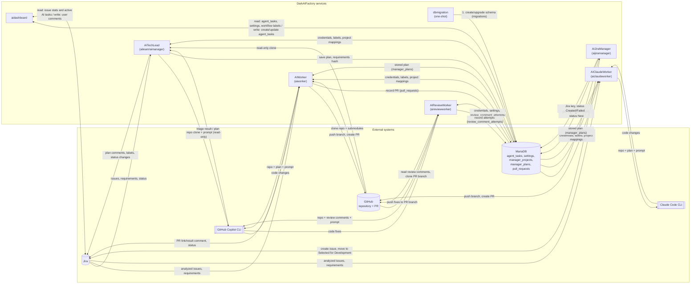

# DarkAIFactory

DarkAIFactory is DarkFactor's AI automation project. This repository currently
contains a Jira-driven coding agent and a small ASP.NET Core web application.

## Projects

- **Jira Coding Agent** — a Dockerized worker that picks up Jira tasks, uses
  GitHub Copilot CLI to implement them in a target repository, and opens pull
  requests. See [the AI worker README](aiteam/aiworker/README.md) for setup,
  configuration, and tests.
- **Jira Claude Coding Agent** — the same worker using the Claude Code CLI
  instead of Copilot (`aiteam/aiclaudeworker`). See
  [the AI Claude worker README](aiteam/aiclaudeworker/README.md).
- **Review Worker** — solves pull-request review comments: it fetches
  comments from the reviewer on the agent's pull requests, runs Copilot CLI to
  fix them and pushes to the PR branch (`aiteam/aireviewworker`). See
  [the review worker README](aiteam/aireviewworker/README.md).
- **aidashboard** — a minimal ASP.NET Core application.
  See [the aidashboard README](aiteam/aidashboard/README.md).
- **dbmigration** — a one-shot executable that creates and upgrades the shared
  database before clients start. See [the migration README](aiteam/dbmigration/README.md).

## Architecture / Dataflow



Notes:

- The AITechLead *is* the `aimanager` project; its folder, DB client key and
  file names still say `aimanager`.
- Jira, GitHub, Copilot CLI and MariaDB are external; the other nodes are
  services in this repository.
- Arrows show the direction of the data; the label is its content. Run
  dbmigration before starting any other service.
- The triage result reaches the worker through MariaDB (`manager_plans`) and
  Jira labels, not through a direct call.

## Agent skills

Shared agent skills are provided by the `.agents/skills` Git submodule. Clone
this repository with submodules:

```sh
git clone --recurse-submodules https://github.com/DarkFactorAS/DarkAIFactory.git
```

For an existing checkout, initialize or update submodules with:

```sh
git submodule update --init --recursive
```

## CI

Pushes to `main` and pull requests run the worker and manager .NET and Docker
workflows in [.github/workflows](.github/workflows). The worker .NET workflow
also builds aidashboard and builds/tests dbmigration. Docker CI uses the shared
`infrastructure-server-ci.yml@v1.7` workflow from `DarkFactorAS/Infrastructure`.

### Review worker setup

The review worker (compose service `review-worker`) runs after `dbmigration`
and reads the same `aiteam/config/appsettings.<Environment>.json` as the other
workers (`PollIntervalSeconds`, `ReviewerLogin`, `MaxAttemptsPerPullRequest`; see
[its README](aiteam/aireviewworker/README.md)). Export `NUGET_USERNAME` and
`NUGET_TOKEN` (see `aiteam/.env.example`) and start it with
`docker compose -f aiteam/docker-compose.yml up -d review-worker`.
The GitHub token stored in the `settings` table needs these permissions on the
target repository:

- Contents: write (clone and push fixes to the PR branch)
- Pull requests: read (read review comments)

### AI auto-approve

`.github/workflows/ai-approve.yml` uses GitHub's built-in CLI and REST API to
approve a pull request targeting `main` or `develop` only after Copilot submits a
review on the current head with no inline comments. It does not check out or run
pull request code. The workflow requires an `ai-approval` environment configured
with deployment branch restrictions for `main` and `develop`, containing:

- Secret `GH_TOKEN`: fine-grained PAT of a dedicated bot account (not the PR
  author) with Pull requests: write. Store it in the protected environment, not
  as a repository secret.
- Variable `GH_USERNAME`: the bot account's login.
- Optionally, branch protection requiring the bot's approval.

## Deployment

The [Deploy - Production](.github/workflows/deploy.yml) workflow deploys
DBMigrator, AITechLead (`aiteam/aimanager`), AIWorker, AIClaudeWorker
(`aiteam/aiclaudeworker`), AIReviewWorker (`aiteam/aireviewworker`) and AIJiraManager
(`aiteam/aijiramanager`) using the reusable
`infrastructure-server-deploy.yml` workflow, pinned to `v1.7`. It runs only via
manual `workflow_dispatch` and deploys only to `production`. The jobs run in
order: DBMigrator, then AITechLead, then AIWorker, then AIClaudeWorker, then AIReviewWorker, then AIJiraManager. Deployments are serialized.

The [AI dashboard](.github/workflows/aidashboard-deploy.yml) keeps its own
separate deployment workflow.

### Required GitHub setup

- A self-hosted Linux runner with Docker and access to the private reusable
  Infrastructure workflow.
- A GitHub environment named `production` (and `staging` for the dashboard),
  with any desired approval rules.
- Secrets `NUGET_USERNAME` and `NUGET_TOKEN`.
- Database settings for all three clients: variables `DATABASE_SERVER`,
  `DATABASE_PORT`, `DATABASE_NAME`, and secrets `DATABASE_USERNAME`,
  `DATABASE_PASSWORD`, available to each environment.
- Repository variables `AIDASHBOARD_STAGING_PORT` and
  `AIDASHBOARD_PRODUCTION_PORT`, containing distinct numeric host ports
  (1-65535). These are repository variables because reusable-workflow inputs
  cannot read the called job's environment variables.

The agents pass `external_port: 0` because they have no HTTP listener; the
Infrastructure workflow nevertheless publishes an unused ephemeral port.
All three clients require the same configured database for Jira/GitHub settings.
Run dbmigration against that database before deploying any client. The deploy
workflow does this by deploying DBMigrator first; Compose handles it locally.
Clients no longer create tables.

### Deployment blockers

**These entrypoints are not yet working deployments.** They intentionally use
the existing Infrastructure workflow unchanged; compatibility must be addressed
there before running them:

- Infrastructure unconditionally substitutes database values in
  `<project_path>/Config/appsettings.<environment>.json`. This repository instead keeps ignored runtime JSON under
  [aiteam/config](aiteam/config), with `Production`, `Development`, and
  `Acceptance` filename casing. The expected staging/production files
  do not exist at the Infrastructure paths.
- Images deliberately exclude runtime configuration. Infrastructure must
  support read-only configuration mounts for database credentials rather than
  baking Jira/GitHub credentials into images. Jira/GitHub credentials live in
  the shared database, not in images.
- Infrastructure sets only `ASPNETCORE_ENVIRONMENT` to lowercase `staging` or
  `production`. Agents select configuration using `DOTNET_ENVIRONMENT`, and
  the web app selects the exact ASP.NET Core environment filename. Environment
  selection and config filenames must be aligned for all three apps.
- Infrastructure does not join the Compose database network. All three
  client containers need network access to the configured MariaDB host;
  `aiteam_database` is only resolvable on its Docker network.
- Infrastructure starts detached containers without checking application
  readiness. Successful startup must be verified before promoting to production.

The dashboard now has a [Dockerfile](aiteam/aidashboard/Dockerfile) using the
same NuGet BuildKit secrets as the agents. It requires a runtime config mount
at `/app/Config` (aidashboard uses its own `aiteam/aidashboard/Config` folder) and database access, just like local deployment.
